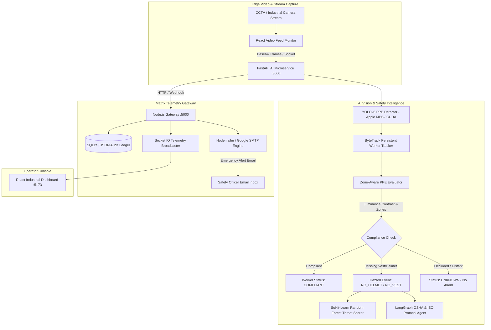

# VigilOps AI — Autonomous Real-Time Industrial Safety & PPE Monitoring Platform

[](#system-architecture)
[](#ai-services)
[](#ai-services)
[](#telemetry-gateway)
[](#web-dashboard)
[](#alerts-service)

**VigilOps AI** is an enterprise-grade industrial safety monitoring system engineered for high-risk manufacturing, fabrication, and construction environments. It continuously analyzes video streams, tracks personnel with ByteTrack, evaluates personal protective equipment (PPE) compliance using a custom-tuned YOLOv8 model, calculates predictive threat probabilities via machine learning, retrieves verified OSHA/ISO safety protocols using LangGraph RAG, and dispatches automated emergency notifications over SMTP.

---

## Key Capabilities

- **Zero-Latency PPE Object Detection**: Fine-tuned YOLOv8 model detecting Hard Hats, Safety Vests, Persons, and industrial machinery (forklifts, cranes).
- **Multi-Worker Spatial Association & Posture Defense**: Zone-bounded vertical coordinate mapping (`[-0.12, +0.38]` for head, `[+0.18, +0.72]` for torso) tied to individual ByteTrack persistent IDs.
- **Ordinary Shirt False-Positive Elimination**: Advanced optical retroreflective stripe analysis requires luminance step contrast ($\Delta L > 22.0$) or high YOLO confidence ($\ge 0.40$), preventing regular bright clothing from erroneously registering as high-visibility PPE.
- **Occlusion-Resistant Fallback (`UNKNOWN` Status)**: Worker crops smaller than $50\text{px}$ or intersecting camera boundaries fall back to an `UNKNOWN` state to prevent false-alarm fatigue.
- **Predictive Risk Engine**: Random Forest ML model dynamically correlates worker density, hazard proximities, violation count, and operational velocity into a predictive threat index (0–100%).
- **LangGraph OSHA/ISO Safety Protocol Retrieval**: Context-aware RAG agent retrieves binding regulatory standard operating procedures (SOPs) based on detected incident conditions.
- **Real-Time Matrix Telemetry Gateway**: Node.js & Socket.IO server streaming bi-directional alerts, incident life-cycles (Acknowledge, Resolve), and persistent audit trails.
- **Automated Incident Notification**: Instant Google SMTP dispatch to registered Safety Officers with rich contextual hazard information and emergency action guidelines.
- **Industrial Operator Dashboard**: High-density React interface featuring an unobstructed video canvas, real-time threat gauges, protocol viewers, recipient management, and audit history.

---

## System Architecture



---

## Project Structure

```text
VigilOps AI/
├── ai_services/                # FastAPI AI microservice
│   ├── main.py                 # Core API endpoints & frame processing
│   ├── models/                 # Model checkpoints (YOLOv8, Random Forest)
│   │   ├── yolov8n_ppe.pt      # Production fine-tuned PPE weights
│   │   └── risk_rf.pkl         # Trained threat prediction model
│   ├── rag_sop.py              # LangGraph OSHA/ISO safety protocol agent
│   ├── risk_engine.py          # Threat scoring calculations
│   └── requirements.txt        # Python dependencies
├── backend/                    # Node.js Matrix Telemetry Gateway
│   ├── server.js               # Express & Socket.IO server
│   ├── alertService.js         # Gmail SMTP dispatch & rate-limiting
│   ├── incidentManager.js      # Audit ledger & persistence
│   ├── .env.example            # Environment variable template
│   └── package.json            # Node backend dependencies
├── frontend/                   # React Industrial Monitoring Dashboard
│   ├── src/                    # Components, state, and UI
│   │   ├── App.jsx             # Main dashboard layout & control room
│   │   └── components/
│   │       ├── VideoStream.jsx # Unobstructed video feed & bounding box canvas
│   │       ├── ThreatGauge.jsx # Dynamic threat level gauge
│   │       └── ...
│   ├── package.json            # Frontend dependencies
│   └── vite.config.js          # Vite build configuration
├── sample_audit_videos/        # Sample audit video files for demonstration
├── .gitignore                  # Git ignore rules (protecting secrets and heavy datasets)
├── package.json                # Root orchestration scripts
└── README.md                   # System documentation
```

---

## Quick Start (Manual Setup)

### 1. Clone the Repository
```bash
git clone https://github.com/Aathithyaa-1531/VigilOps-AI.git
cd VigilOps-AI
```

### 2. Configure Environment Variables
Copy the sample environment file in the `backend/` directory:
```bash
cp backend/.env.example backend/.env
```
Update `backend/.env` with your desired configuration (e.g. SMTP credentials, port assignments).

---

### 3. Running Services

#### Option A: Single Command Startup *(Quickest)*
```bash
npm install
npm start
```

#### Option B: Individual Terminals *(Recommended for Development)*

**Terminal 1 — AI Vision Engine (FastAPI)**:
```bash
cd ai_services
python3 -m venv venv
source venv/bin/activate
pip install -r requirements.txt
uvicorn main:app --host 0.0.0.0 --port 8000 --reload
```

**Terminal 2 — Gateway & Alerting (Node.js)**:
```bash
cd backend
npm install
node server.js
```

**Terminal 3 — Industrial Dashboard (React + Vite)**:
```bash
cd frontend
npm install
npm run dev
```

Open your browser at [http://localhost:5173](http://localhost:5173).

---

## Health Check & Verification Endpoints

- **FastAPI AI Microservice**: `GET http://localhost:8000/health`
- **Telemetry Gateway**: `GET http://localhost:5000/health`
- **Incident Audit History**: `GET http://localhost:5000/api/incidents`
- **Emergency Drill Dispatch**: `POST http://localhost:5000/api/alerts/test`

---

## License

This project is licensed under the MIT License — see the LICENSE file for details.
